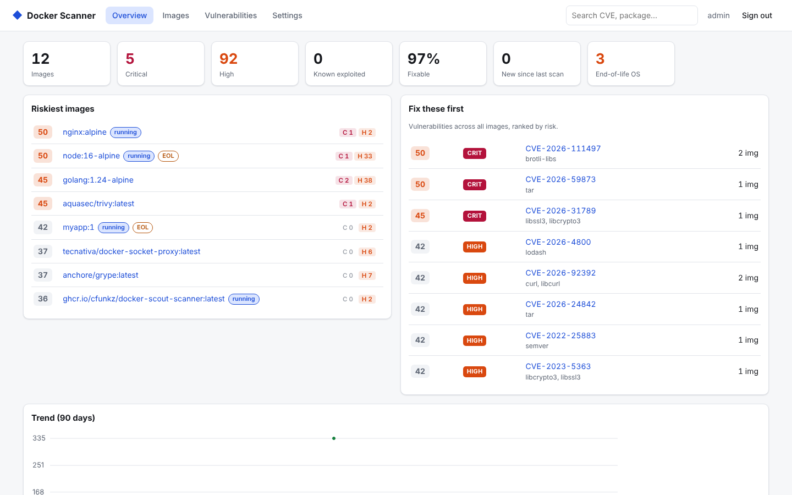
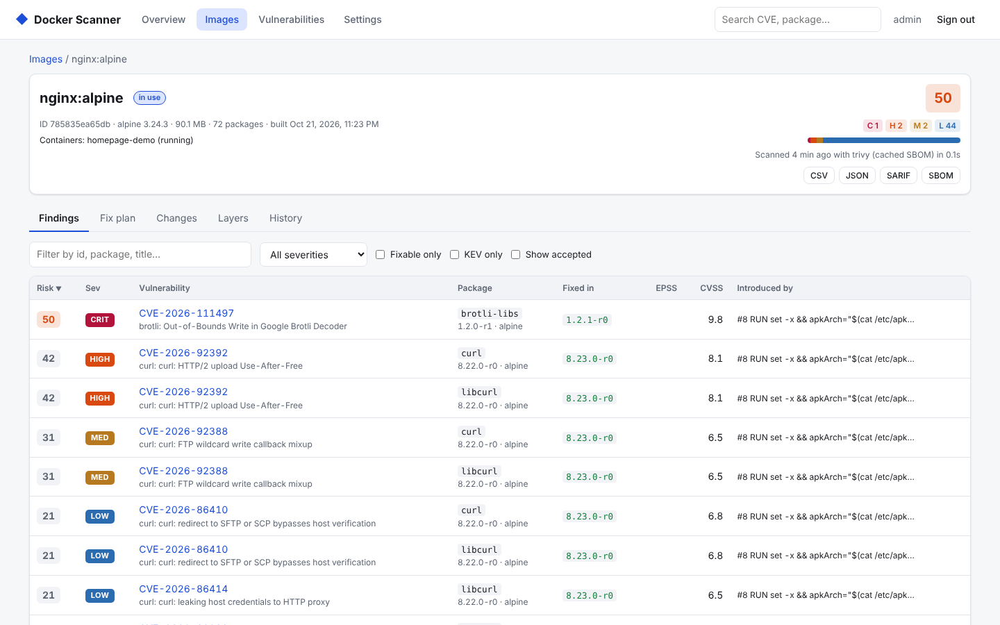
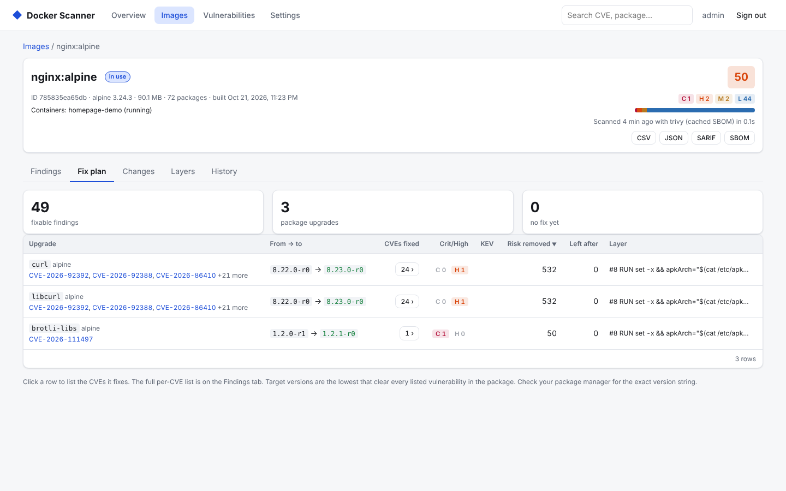
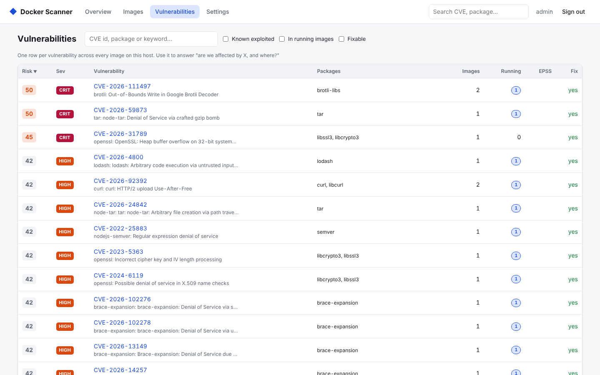
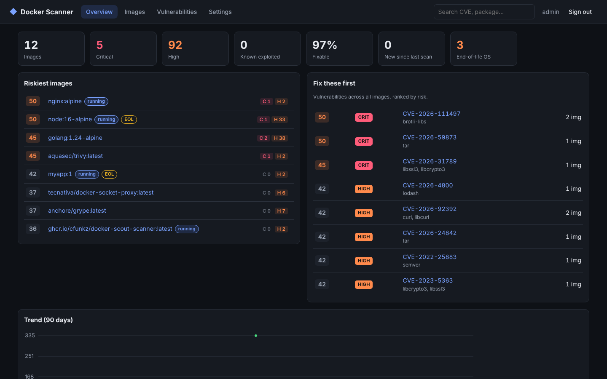
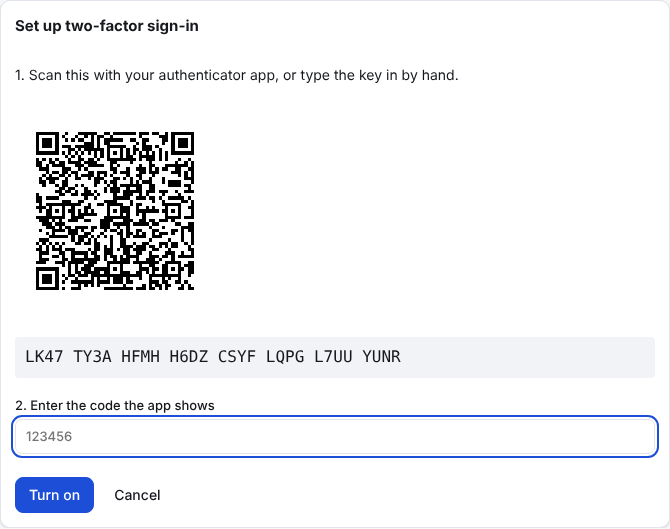
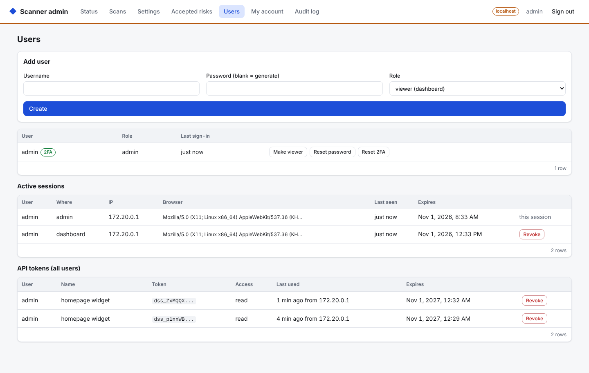

# Docker Scout Scanner

A self-hosted vulnerability dashboard for the images on your Docker host.

It finds every image on the machine, scans it with [Trivy](https://github.com/aquasecurity/trivy) (and [Grype](https://github.com/anchore/grype) if you want a second opinion), and shows you what's affected, how much it matters, and which upgrade fixes the most. Small, quick, and made for homelabs: three containers, no database server, no cloud account.



## Features

- **Scans everything on its own.** New pulls and builds are picked up from Docker events within seconds. Each image shows which containers use it and whether they're running.
- **Ranks what matters.** Every finding gets a 0–100 risk score from its severity, [EPSS](https://www.first.org/epss/) (how likely it is to be exploited), the [CISA KEV](https://www.cisa.gov/known-exploited-vulnerabilities-catalog) list (known to be exploited), whether a fix exists and whether the image is running.
- **Tells you what to do.** The fix plan groups findings by package and shows the upgrade that clears them, sorted by how much risk each one removes. Each CVE is traced to the Dockerfile line that added it, so you know whether to bump the base image or fix your own `RUN` step.
- **Fast rescans.** Each image is read from Docker once and stored as an SBOM. Later scans, including the automatic re-check after every database update, run against that SBOM and take well under a second per image.
- **See what changed.** New and resolved CVEs since the last scan, or since the previous build of the same tag.
- **Search across images.** Look up a CVE or package and see every image that has it.
- **Accepted risks.** Mute a finding with a reason and an expiry date. Rules export as OpenVEX for use in CI.
- **Alerts.** Webhooks for ntfy, Discord, Slack or anything else, sent only for *new* findings that match your rules.
- **Exports.** CSV, JSON, SARIF and CycloneDX SBOM per image, plus Prometheus metrics.
- **Accounts.** Viewer and admin roles, two-factor sign-in with any authenticator app, and API tokens for scripts and dashboards.
- **Dark mode**, and it works fully offline once the databases are downloaded.

| Image detail | Fix plan |
|---|---|
|  |  |
| **All vulnerabilities** | **Dark mode** |
|  |  |
| **Two-factor setup** | **Admin panel** |
|  |  |

## Install

You need Docker with the Compose plugin. Images are published for amd64 and arm64.

```bash
git clone https://github.com/cfunkz/docker-scout-scanner.git
cd docker-scout-scanner
./scanner.sh install
```

The script creates `.env`, starts the stack, waits until it's healthy, and then prints:

```
Dashboard:   https://192.168.1.15:8443
Admin panel: https://127.0.0.1:8444   (on this machine only)
Login:       admin / hgLt-IllPpYg16-u7f4U
```

Open the dashboard, accept the self-signed certificate, and sign in. You'll be asked to pick your own password. The first scan starts by itself, and downloading the vulnerability database takes a minute or two the first time.

It uses the prebuilt images from GitHub Container Registry. If they aren't available (or you run `./scanner.sh build`), it builds them from the source in this folder, which takes about 10 minutes.

### Script commands

| Command | What it does |
|---|---|
| `./scanner.sh install` | Start everything and print the URLs and login |
| `./scanner.sh status` | Show the containers and URLs |
| `./scanner.sh password` | Reset the admin password and print a new one |
| `./scanner.sh reset-2fa` | Turn off two-factor sign-in for a user who lost their phone |
| `./scanner.sh logs` | Follow the logs |
| `./scanner.sh update` | Pull the latest version and restart. Your data stays |
| `./scanner.sh build` | Build the images from this checkout and restart |
| `./scanner.sh stop` | Stop. Your data stays |
| `./scanner.sh reinstall` | **Delete all data** and start fresh (asks first) |
| `./scanner.sh uninstall` | **Delete** the containers, volumes and images (asks first) |
| `./scanner.sh agent-certs <host>` | Make the TLS files for watching another Docker host |

### Plain Docker Compose

```bash
cp .env.example .env
docker compose up -d
docker compose logs scanner | grep "admin account"
```

The data lives in the `docker-scanner_scanner-data` volume. It survives `docker compose down` and fresh clones, so on a reinstall no new password is generated. Use `docker compose exec scanner scanner reset-password admin` to get a new one.

### Passwords and staying signed in

Passwords are stored as bcrypt hashes in the data volume, so a password you change in the web UI survives restarts, updates and `docker compose down`. The scanner never writes your password back into `.env` in plain text.

If you'd rather manage the admin password from `.env`, set `ADMIN_PASSWORD` (12+ characters) and restart. A new value is applied once on the next start, also on an existing install, and signs out that user's sessions. After that the web UI owns the password again until you change `ADMIN_PASSWORD` to something else. You can clear the line once it has been applied.

You stay signed in for 7 days of inactivity, across browser and server restarts. Change it under *Admin → Settings → Stay signed in for*. Admin panel sessions end after 8 hours.

### Runtipi

The [`runtipi/`](runtipi/) folder is a ready-made Runtipi app. See [runtipi/README.md](runtipi/README.md) for how to add it to your Runtipi.

## Using it

**Dashboard** (`https://<server>:8443`): overview, images, the vulnerability list, and your own settings: theme, password, two-factor sign-in and API tokens.

**Admin panel** (`https://127.0.0.1:8444`): scanner settings, scan controls, users, accepted risks, API tokens of all users, and the audit log. It only listens on the server itself. From another computer, use an SSH tunnel:

```bash
ssh -L 8444:127.0.0.1:8444 you@server
# then open https://127.0.0.1:8444
```

**Two-factor sign-in:** Settings → Two-factor sign-in → Set up. Scan the QR code with Aegis, 2FAS, Bitwarden, Google Authenticator or similar, then save the ten recovery codes. If you lose both, run `./scanner.sh reset-2fa <user>` on the server, or ask an admin to use *Users → Reset 2FA*.

## API

Create a token under **Settings → API tokens** and send it as a header:

```bash
curl -k -H "Authorization: Bearer dss_..." https://192.168.1.15:8443/api/overview
```

Read-only tokens work on both ports. Admin tokens can also change things, but only on the admin port. That's enough for Homepage or Home Assistant widgets, scripts and CI checks. All endpoints are listed in [docs/API.md](docs/API.md).

## Security

The dashboard is meant to be reachable on your LAN or through a reverse proxy. The admin panel is meant for the server only.

- **HTTPS by default.** TLS 1.2/1.3 with a self-signed certificate made on first start, or your own. Port 8080 only redirects to HTTPS.
- **Sign-in.** bcrypt passwords (12+ characters), optional TOTP two-factor with single-use recovery codes, account lockout and login rate limits. Sessions are random tokens stored as hashes, in `__Host-` cookies that are `HttpOnly`, `Secure` and `SameSite=Strict`, with a CSRF token per session.
- **Admin is separate.** The admin API runs on its own listener and port, bound to `127.0.0.1`. The dashboard port doesn't have the admin routes at all, so a reverse proxy can't expose them by mistake.
- **Read-only Docker access.** The scanner never touches the Docker socket. A small built-in proxy only lets through reading image and container lists, image metadata and exports, and events. Starting containers, `exec`, reading container files and every other write are refused.
- **Locked-down containers.** Non-root where possible, read-only filesystems, all capabilities dropped, internal networks. Only the scanner can reach the internet, and only to download vulnerability data.
- **Clean images.** The scanner image is built `FROM scratch` with Trivy and Grype compiled from source on the latest Go. The web image is `nginx:alpine` with curl and the unused modules removed. At the time of writing, both scan clean apart from Docker daemon CVEs that get reported against the Docker client library inside Grype. Set `WITH_GRYPE=false` if you don't need Grype.
- **Small footprint.** About 10 MB of RAM for the scanner and 5 MB for nginx when idle. Images being read during a scan are buffered on disk in the data volume, not in RAM. `SCANNER_MEM_LIMIT` (default 1g) caps the scanner.
- **Audit log** of sign-ins, failures, setting changes, user and token changes.
- **No telemetry.** Offline mode makes no network calls at all.

## Behind a reverse proxy

Point the proxy at `https://<server>:8443` and tell the stack which proxy addresses to trust, so logs and rate limits see real client IPs:

```dotenv
# .env
TRUSTED_PROXIES=10.0.0.5         # or a range such as 172.16.0.0/12
DASHBOARD_BIND=127.0.0.1         # if the proxy runs on the same machine
```

Caddy example:

```caddy
scanner.home.lan {
    reverse_proxy https://127.0.0.1:8443 {
        transport http {
            tls_insecure_skip_verify
        }
    }
}
```

Traefik and Nginx Proxy Manager work the same way: forward to port 8443 over HTTPS and skip certificate verification (or trust the generated certificate).

If your proxy can only talk plain HTTP to the backend, set `HTTP_MODE=proxy`. Port 8080 then serves the dashboard without TLS, but only to the addresses in `TRUSTED_PROXIES`.

### Putting it on the internet

It's built for a LAN, but it can sit behind a public reverse proxy. If you do:

- Keep the admin panel off the internet. It only listens on `127.0.0.1` anyway; reach it over SSH.
- Turn on two-factor sign-in for every account and keep *Require sign-in* on.
- Set `TRUSTED_PROXIES` to your proxy only, so rate limits and lockouts see real client IPs.
- For scripts and dashboards, use read-only API tokens with an expiry date.
- Better still, put it behind your proxy's own sign-in (Authelia, Authentik, Cloudflare Access) or a VPN.

## Scanning another Docker host

One stack watches one Docker host. The simplest way to cover several machines is to install it on each one; it needs about 10 MB of RAM when idle.

To watch a host that shouldn't run the full stack (a NAS, a small VPS), run only the read-only agent there and point a scanner at it. This uses Docker's own `tcp://` plus mutual TLS scheme, so nothing new is invented: the agent is the same allowlist proxy the stack already uses, and it only answers clients holding the certificate you generate.

1. On the scanner machine, make the certificates (name or IP of the remote host):
   ```bash
   ./scanner.sh agent-certs nas.lan 192.168.1.20
   ```
2. Copy `docker-compose.agent.yml` and the `agent-certs/agent/` folder to the remote host, keeping the layout, and start it there:
   ```bash
   docker compose -f docker-compose.agent.yml up -d
   ```
   It listens on port 2376. Allow that port only from the scanner's IP in your firewall.
3. On the scanner machine, set `REMOTE_DOCKER_HOST=nas.lan` in `.env` and run `./scanner.sh install`.

The first scan of each image copies it over the network once; later rescans use the stored SBOM. To watch the remote host over the internet, use a VPN such as WireGuard or Tailscale rather than opening port 2376.

## Your own certificate

Put `cert.pem` (full chain) and `key.pem` in a folder and mount it instead of the generated one:

```yaml
# docker-compose.override.yml
services:
  scanner:
    volumes: ["./certs:/certs"]
  web:
    volumes: ["./certs:/certs:ro"]
```

Otherwise the generated certificate covers `localhost`, `127.0.0.1` and the names in `TLS_SANS`. The install script puts your LAN IP there.

## Settings

Ports, addresses, the first admin account and similar options go in `.env`. [`.env.example`](.env.example) explains each one.

Everything else is in **Admin panel → Settings** and applies without a restart:

| Setting | Default | |
|---|---|---|
| Engine | Trivy | Grype, or both merged |
| Parallel scans | 2 | |
| Full rescan | every 24 h | Images are also re-checked after each database update |
| Scan new images right away | on | |
| Only images used by containers | off | |
| Exclude | none | Patterns such as `k8s.gcr.io/*` |
| Secret scanning | off | Looks for keys and tokens left in image layers |
| Database update | every 12 h | |
| EPSS and KEV | on | |
| Offline mode | off | |
| Webhook alerts | off | New criticals and new KEV entries by default |
| Require sign-in | on | |

## Updating and backups

- **Update:** `./scanner.sh update`. The database schema upgrades itself.
- **Backup:** everything is in the `scanner-data` volume:
  `docker run --rm -v docker-scanner_scanner-data:/d -v "$PWD":/b alpine tar czf /b/scanner-backup.tgz -C /d .`
- **Disk use:** a few hundred KB per image. *Admin → Status → Maintenance* can forget removed images, prune history and compact the database.

## Building and development

```bash
cd backend
go test ./...
```

The UI in `web/` is plain JavaScript and CSS with no build step. `./scanner.sh build` builds both images from your checkout. Pushing a tag such as `v1.0.0` runs the release workflow, which publishes multi-arch images to `ghcr.io`.

Layout:

```
backend/   Go API, scheduler, Docker socket proxy (one binary)
web/       dashboard and admin UI
nginx/     TLS, headers, rate limits
runtipi/   Runtipi app files
```
